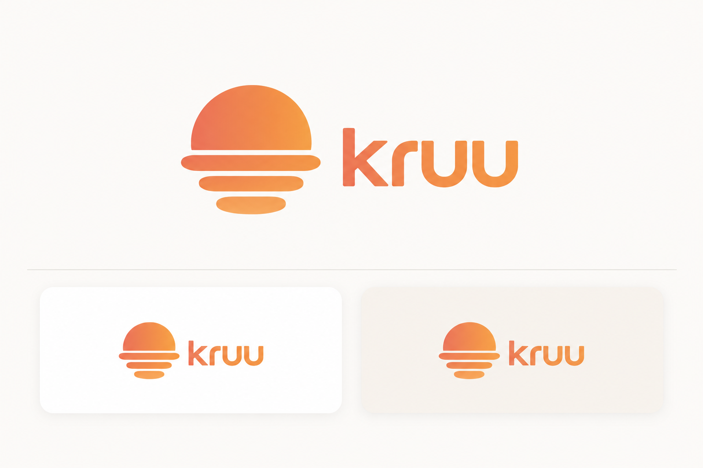

# Soft Signal — Kruu warm-neutral design language

Light, airy, tactile, and clear enough to use outside. A warm utility for people coordinating real work.

This is a proposed design system, derived from the five supplied references and HeatShift's planning workflow. Kruu is the name used in this approved visual direction; repository and deployment naming are outside this handoff. It describes visual and interaction decisions, not new product capabilities. The accompanying specimen uses illustrative data.

## Approved logo direction — October 10, 2026

Use the ripple sun with exactly three separated, progressively shorter reflection bands. Pair it with the smaller lowercase **kruu** wordmark, vertically centered beside the symbol. Match the coral-to-orange treatment in the approved image; keep the icon and wordmark proportions, generous space, and quiet rounded surfaces.

The attached PNG is the approved visual mockup, including its presentation cards and background. It is not a transparent logo or production vector; do not use the whole board as an application header. Its lettering is illustrative rather than a verified font rendering. Manrope remains the heading font direction, with DM Sans for interface copy. A production logo export and application integration are separate work.

The foundation values below translate the approved no-green direction into reusable tokens. Keep the brand gradient fixed; temperature-driven colors belong to the forecast component only. Use dark text for small labels and controls rather than extending the logo gradient to operational text.

## The reference synthesis

- **Autonomous finance reference:** generous negative space and one dominant number. Borrow that hierarchy within the light palette.
- **Auro overview and settings references:** light surfaces, compact rounded controls, human typography, and gently diffused daylight. The latest direction replaces the earlier sage palette with warm ivory, white, and cream.
- **Thermostat reference:** a contained warm glow and a large temperature with a clearly selected control. Use the glow only in the forecast panel, with explicit units and labels.
- **Daily-summary reference:** conversational introductions and a clear next action. Make the next task or planning action easy to find.

Do not inherit tiny labels, faint text, hidden double-tap gestures, decorative metrics, or indistinguishable toggles from the references.

## Foundations

| Role | Value | Use |
| --- | --- | --- |
| Canvas / ivory | #FCFAF7 | Full-page background |
| Surface / white | #FFFFFF | Forms, task cards, dialogs |
| Secondary / warm cream | #F7F2EB | Selected groups, supporting areas |
| Primary ink / charcoal | #38322E | Text and icons |
| Primary action / soft peach | #F0DDC9 | Button fill with charcoal text |
| Secondary ink / warm gray | #6B625B | Helper text and metadata |
| Control boundary | #8C7E72 | Essential input and control boundaries |
| Divider | #E6DFD7 | Decorative separators only |
| Warm accent / oat | #F1D8B9 | Forecast illustration, never small text |
| Warm wash | #FBF5E9 | Forecast background |
| Comparison accent / neutral stone | #EEEAE5 | Comparative weather illustration |
| Warning ink / ochre | #76501F | Warning text on #FFF0D6 |
| Error ink / brick | #A13228 | Error text on #FBE9E5 |

Keep the overall interface predominantly white and off-white with soft peach controls. The weather panel is the concentrated warm-color area; the logo uses a restrained coral-to-orange gradient. Avoid green, sage, olive, or mint undertones in surfaces, ink, shadows, and controls. Keep this direction light regardless of system appearance. This is a composition guide, not a quota. White or pale text must not sit directly on a pale gradient. Keep a solid text zone inside atmospheric cards.

Use semantic color names in code. Oat is forecast context, not a universal warning. A neutral selected surface indicates selection or an ordinary completed action, never a guarantee of safe working conditions. Pair every status with a label and, where useful, an icon.

## Typography and spacing

Use **DM Sans** for body text and **Manrope** for headings. Use system sans-serif fallbacks. Body text is 16px/1.5, labels 14px/1.4, metadata at least 12px/1.5. Headlines are 32–48px at weight 500, section headings 22px at 500–600. Temperature or result values are 56–72px at 400, with visible units and explanatory labels. Use tabular numbers for aligned times and comparison values.

Use a 4px spacing base: 4, 8, 12, 16, 24, 32, 48. Mobile page gutters are 20px; desktop gutters are 32–48px. Card padding is 20–24px. Keep 24–32px between major groups. Give controls a minimum 48px touch height and separate nearby actions by at least 8px.

Cards use 24px corners; featured forecast panels use 32px; fields use 12px; short buttons and chips may use pill shapes. Long labels wrap. Avoid rounded containers inside every rounded container. Use a quiet border or a soft shadow, not multiple competing depth effects.

## Signature components

**Forecast panel.** One large apparent-temperature value, labeled “Feels like,” with °F or °C. Put location, forecast date, source and update time nearby. Use a richer sun-colored gradient in this panel while keeping the rest of the interface light. Interpolate continuously from golden yellow (#F2CF65) at 75°F through orange (#F2A34F) at 90°F to warm red (#E9826D) at 105°F. These are visual anchors, not medical or safety thresholds. Clamp the color outside that range while always displaying the actual temperature. Normalize Celsius to Fahrenheit before interpolation. Use the displayed apparent (feels-like) temperature, not air temperature. Missing values use a neutral panel and an unavailable label. Keep text dark brown (#382B22) throughout the gradient. Color reinforces the labeled numeric temperature; an hourly strip in the app carries the actual forecast values. Mark the selected hour with a solid outline or filled pill and a text label. Label hottest-hour highlights relative to the selected shift; do not invent clinical risk thresholds.

**Task card.** Lead with task title. Group start–end time, duration and indoor/outdoor state beneath it. Show fixed appointments and dependencies explicitly. Keep editing accessible through a visible “Edit task” control. Expanded details use the same surface. Missing required values get a field-level message and an error summary.

**Schedule comparison.** Keep Original and Proposed on the same time scale with the same task identities. Use solid, readable blocks with direct labels. Breaks and paid availability remain visible. Show the actual metric as “Outdoor minutes in the three hottest forecast hours,” followed by original → proposed. Show “No reduction found” when appropriate. Never replace this measure with “safety score,” “risk reduced,” or an unsupported percentage.

**Primary action.** Soft peach fill (#F0DDC9) with charcoal text (#38322E), 48px minimum height, one primary action per stage. Use concrete labels: “Review tasks,” “Compare schedules,” “Review crew briefing,” and “Copy briefing.” Loading keeps the button width stable and replaces its label with the actual operation. Secondary actions use neutral surfaces and a visible boundary.

**Crew briefing.** Put the date and approved schedule first. Make English and Español explicit text choices. Present times and tasks in a scan-friendly list; maintain room for Spanish copy expansion. Keep copy/download actions near the content. A success message must describe what actually happened: “Briefing copied,” not “Crew notified.”

## Layout and behavior

Desktop planning uses a main work column and a narrower forecast column, approximately 2:1. Comparison can span the content width. Mobile stacks the same workflow in reading order; the forecast summary comes before decisions that depend on it. Keep the current stage and one clear next step visible. Do not add an ornamental bottom navigation or account area solely to resemble the references.

Use 160ms feedback for buttons and selection, and 240ms for expanding cards, with ease-out motion. No looping glow, animated thermometer, or decorative number counting. Respect reduced motion. Native inputs and visible focus rings remain intact. Keyboard users must reach every action.

## Required states

- Empty work order: one clear prompt, a labeled example option if available, and the next action.
- Loading: operation-specific text; preserve entered values and layout.
- Missing task details: identify the exact field and correction needed.
- Unavailable or stale forecast: show the reason and retry action; do not leave stale values looking current.
- No improvement: neutral result with an explanation and original plan retained.
- Infeasible schedule: name the conflicting constraints and point back to editing.
- Illustrative/demo fixtures: persistent “Demo data” label adjacent to forecast and result content. When demonstrating live NWS data, show its actual source and timestamp instead; do not label live weather as a fixture.

## Implementation handoff

`tokens.css` supplies proposed variables and two optional surface utilities; it is not imported into the app. Map the semantic tokens into the application stylesheet, keep operational text at the sizes specified above, standardize component spacing, and constrain atmospheric effects to the forecast panel. Reuse the application icon family with consistent stroke weight and visible labels where meaning is ambiguous.

Review final screens at 320px, 390px, 768px and desktop widths, at 200% text zoom, and with keyboard focus. Verify contrast on actual rendered gradients, not only token pairs. The palette's small-text pairs are intended to meet at least 4.5:1; essential control boundaries should meet 3:1. This guide is not a claim that the existing app has passed an accessibility audit.

Reusable direction: “Use Soft Signal: warm ivory canvas, white cards, cream selections, charcoal typography, a contained yellow-to-orange-to-red temperature-driven forecast glow, generous spacing, readable operational text, 24px cards, 48px controls, and one clear next action. Preserve all scheduling facts and label forecast uncertainty.”

## Review assets and checks

- [Standalone visual specimen](preview.html): open the downloaded file in a browser. Values are illustrative. The task button expands example details; the demo temperature slider previews the sun spectrum. The specimen stays light in both system appearances.
- [CSS tokens](tokens.css): proposed variables, not imported by the application.
- Revised warm-neutral specimen visually inspected in the desktop browser; the approved PNG was verified byte-for-byte against the selected image.
- Prior sage version: Chrome layout and task-expansion checks passed at 320, 390, 768 and 1100px. Those historical checks do not verify the revised palette.
- Revised palette calculated contrast: text/canvas 12.11:1; text-secondary/canvas 5.72:1; text-secondary/surface-secondary 5.35:1; on-primary/primary 9.55:1; control-border/surface 3.93:1; focus/canvas 6.34:1. These calculations do not replace a rendered application accessibility review.

### Temperature-color implementation

Linearly interpolate each RGB channel between the two surrounding temperature anchors and round to the nearest integer. Assign the resulting color to `--hs-forecast-color` on the forecast component. Keep the original value and unit in the numeric label, even outside the visual range. Do not apply this scale to error messages or imply that yellow conditions are safe. The specimen slider changes illustrative values only; it does not change the forecast.

Temperature specimen checks: 75°F, 90°F and 105°F map to the specified anchor colors and update the displayed value. Responsive layout checks above refer to the prior version. Dark-brown weather text contrast is 9.04:1 on yellow, 6.59:1 on orange, 5.13:1 on red and 12.15:1 on the pale gradient endpoint.
