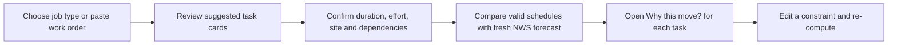

# Work view: personalized job planning and explainable scheduling

**Prepared:** 2026-10-10. **Status:** Proposed interaction and product specification, not implemented. **Observed baseline:** The [deployed work planner](https://heatshift-naxecodes-projects.vercel.app/) opens with a date, paid shift, fixed break, and free-text work order; the fictional landscaping example is prefilled. There is no visible job category selection at the first step. The current app already has Gemma task extraction, editable task confirmation, NWS comparison, and a crew briefing. This document keeps one crew, one Miami location, one day, and no more than four confirmed tasks.

## Product decision

Personalize the *work context*, not a private worker profile. Ask what kind of job the crew is doing, then offer editable task suggestions and ask about dependencies, exertion, site conditions, and fixed commitments. Use those confirmed facts plus forecast data to compare feasible schedules. Explain every proposed move in a way a supervisor and crew can challenge. No account, worker name, medical history, or precise client address is needed.

Choosing **Landscaping** or **Construction** cannot establish the right task sequence by itself. For instance, mowing might follow equipment checks but still belong early in a hot day. Moving heavy outdoor mowing to the end by default could increase heat exposure; [NIOSH advises scheduling heavy work for cooler parts of the day](https://www.cdc.gov/niosh/docs/2010-114/default.html). Construction is even broader: a fixed concrete delivery, inspection, roof work, and indoor prep have different constraints. Templates should be a starting question, never an authority on how to perform the trade.

## First-screen interaction

Replace the blank-work-order-first feeling with this progressive flow:



1. **Choose a work type:** large selectable cards for **Landscaping**, **Construction**, **Road or public works**, and **Other / start from my work order**. These are labeled examples, not claims that all trades are supported. Keep an immediate “Paste my work order” path. Selecting a card updates the form without navigation.
2. **Choose the actual job:** Landscaping offers “Lawn care,” “Tree/hedge work,” or “Other landscaping.” Construction asks a more specific job such as “Exterior work,” “Material handling,” or “Other construction,” then asks what the crew will actually do. A category alone must not fill a schedule.
3. **Build up to four task cards:** Show a few *suggested* task names as checkboxes, then require the user to confirm, edit, or replace them. Each card has duration, outdoor/indoor or hot-indoor setting, physical effort, sun/shade, required PPE, earliest/latest/fixed timing, and “Must happen after…” chips. Use “Unknown” where the user has not confirmed site conditions. Make a small “Why we ask” affordance for effort and PPE: these can change the heat context, though the current forecast-only metric does not establish an occupational safety rating.
4. **Review plan assumptions:** A summary strip reads, for example, “Landscaping · 4 confirmed tasks · 8 AM–4 PM · break 12–12:30 · 1 dependency.” Highlight what is missing before comparing: “Is equipment already checked?” or “Is the delivery time fixed?” A one-tap **Confirm details & compare** action runs the existing scheduling flow.

### Premium-feeling interactions with a purpose

| Interaction | User benefit | Constraint |
| --- | --- | --- |
| Category cards with a short preview of suggested tasks | The first step feels relevant without requiring a perfect written work order. | “Other” and free text always remain available. |
| Editable task cards, dependency chips, and “Unknown” badges | People can correct the AI before a schedule exists. | Suggestions never silently become confirmed facts. |
| Before/after timeline with tap-to-highlight changed tasks | A schedule change is understandable at a glance. | Preserve paid shift, break, duration, dependencies, appointments. |
| “Why this move?” drawer per task | Show the forecast interval, original and proposed time, and the exact constraint/reason. | Computed facts come from deterministic code; Gemma only explains them. |
| “What if this appointment is fixed?” toggle and immediate re-compare | Lets the supervisor explore a real constraint instead of accepting a single answer. | Re-run validation and scheduler; never cosmetically reorder cards. |
| “This doesn't match our site” edit/undo action | Gives the crew a way to challenge assumptions. | Do not store worker identities or ask for sensitive health details. |

Subtle animation can connect a moved card to its new timeline slot, but the reason and times must remain readable without motion. Keyboard buttons must offer the same reordering/inspection as drag-and-drop. The result should have text labels, not only color. Keep the NWS issue time and the comparison metric visible.

## How AI and scheduling should divide the work

Gemma 4 can (a) classify a free-text work order into an editable category, (b) extract up to four tasks into a strict schema, (c) suggest *questions* about likely dependencies or site conditions, and (d) explain verified schedule events in plain English or Spanish. The app's deterministic code validates task count and durations, checks all constraints, obtains fresh NWS data, enumerates feasible placements, computes the comparison, and emits structured reason codes. A job category may populate an editable starter list, but may not determine task duration, order, exertion, or protection requirements without confirmation.

Suggested structured output for intake:

```json
{
  "category": "landscaping",
  "specific_job": "lawn care",
  "tasks": [
    {
      "title": "Mow lawn",
      "duration_minutes": null,
      "environment": "outdoor",
      "effort": "unknown",
      "must_follow_task_ids": [],
      "fixed_start": null,
      "confirmed": false
    }
  ],
  "questions": ["Have the mower and site been checked before this task?", "How long will mowing take?"],
  "conflicts": []
}
```

`null`, `unknown`, and `confirmed: false` are deliberate: a template or model must not invent durations, shade, PPE, or readiness. The actual data contract should extend the current validated task schema rather than replacing it abruptly. Model output requires validation, consistent with [Gemma 4 function-calling guidance](https://ai.google.dev/gemma/docs/capabilities/text/function-calling-gemma4).

The scheduler should return reason codes such as `dependency_preserved`, `fixed_start_preserved`, `lower_forecast_exposure`, `no_feasible_improvement`, or `forecast_incomplete`. A task-level explanation can then say: “Mowing moved from 12:30 PM to 9:30 AM because equipment check finishes at 9:30, the task is flexible, and the displayed NWS apparent temperature is lower at the proposed time.” The exact values and times must be computed from that run, cited with the forecast issue time, and checked against the confirmed tasks. If there is no valid improvement, explain why instead of inventing a positive outcome.

## Two illustrative walkthroughs (assumptions, not trade advice)

**Landscaping, fictional:** The supervisor selects **Landscaping → Lawn care**. Four *suggested* cards appear: equipment/site check, mowing, hedge work, cleanup. The supervisor confirms durations, says the mower check must precede mowing, marks mowing and hedge work as outdoor, and confirms the rest. The app may move mowing to the earliest feasible cooler window **after** the check and place lower-exertion or indoor work later if those settings are true. If wet turf, client access, equipment readiness, or noise rules prevent early mowing, the supervisor enters that constraint; the reason panel explains why it could not move. It should never assert “mowing always goes first” or “mowing always goes last.”

**Construction, fictional:** The supervisor selects **Construction → Exterior work** and enters site briefing, delivery-dependent installation, material staging, and cleanup. A 10 AM delivery is fixed and the installation cannot start before it. The app can compare placements of genuinely flexible staging/cleanup; it cannot reorder installation ahead of delivery or generate engineering/construction instructions. If all heavy tasks remain in hot hours, it should say the schedule cannot solve that exposure and prompt the team to use its existing heat procedures and worksite assessment. [OSHA says heat hazards depend on job, environment, and worker](https://www.osha.gov/heat-exposure/hazards), while [NIOSH notes construction PPE and workload affect heat stress](https://www.cdc.gov/niosh/blogs/2020/heat-stress-construction.html). The forecast alone is insufficient for a safety judgment.

## Release order and acceptance checks

**First, feasible before a demo freeze:** Add category cards and a reviewed set of editable starter task names for Landscaping and Construction/Other. Keep the existing free-text route. Add the “Why this move?” drawer using existing computed schedule data, and show unknown dependencies instead of guessing them. This is most of the perceived personalization without changing the scheduling rules.

**Next, after verification:** Add effort, shade/site heat, and PPE fields to the confirmed task contract; update the scoring model and tests before claiming intensity-aware scheduling. Add interactive what-if controls only when they trigger the real scheduler. Multi-crew or building-code guidance is outside the current one-day scope.

Acceptance scenarios: category switched after editing → warn before replacing user edits; no duration entered → ask, do not invent; equipment check before mowing → never place mowing first; heavy mowing flexible after check → do not default it to a hotter end-of-day slot; fixed construction delivery → preserve time and dependency; impossible/no-improvement → explain honestly; stale NWS data → no confident forecast comparison; keyboard-only and Spanish users → same controls and complete explanation. Test exact constraints and source values, not whether the model uses preferred prose.

## Open questions for the team and workers

1. Which two actual job types are most recognizable to hackathon visitors and realistic for a four-task demo?
2. For lawn care, when are tools checked, which tasks must precede others, and what practical reasons could prevent early mowing?
3. For construction, which example can be shown without pretending the app knows trade sequencing or site safety requirements?

No worker or supervisor has validated these templates. Treat the examples as prompts for correction, not evidence of a standard workday.

